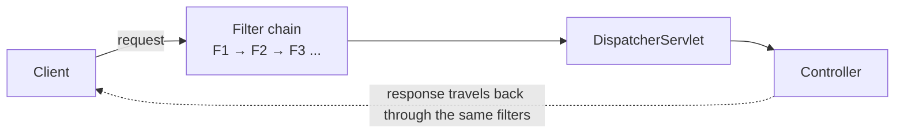

# Spring Security 01 - Filters, Sessions and Basic Auth

**Series:** Spring Security (Spring 6) · **Part 1 of 2** · Next → [[Spring Security 02 - Custom SecurityFilterChain]]

> [!abstract] Executive Summary
> This lesson builds on the default Spring Security login form and explains what happens behind it. It covers who handles security before your controllers run (a **filter chain**), how login persists across requests (**sessions and the `JSESSIONID` cookie**), and how to replace the auto-generated password with your own through **`application.properties`**. It ends by authenticating from **Postman** with **Basic Auth** instead of the browser form. Main takeaway: Spring Security is a set of servlet filters sitting in front of your controllers.

> [!note] Transcript clean-up
> Speech-to-text errors fixed: "surate/serlet" = Servlet, "disp salet" = DispatcherServlet, "Local Host 880" = `localhost:8080`, "heac code" = hex code, "4 41" = 401, "srf" = CSRF. The demo password ("Tesco"/"teliscope") is just a sample value.

> [!warning] This version is fact-checked
> The first draft repeated a few claims from the lecture that are not technically accurate. They are corrected inline and listed in the [[#Fact-check log]] at the end.

---

## Lesson roadmap

| # | Question raised | Answer | Section |
|---|---|---|---|
| 1 | Who handles security when controllers don't mention it? | The security filter chain | [[#1. Who handles security? The filter chain]] |
| 2 | Do I log in on every request? | No, the session remembers you | [[#2. Sessions and the session ID]] |
| 3 | How do I see the session ID? | DevTools or `request.getSession().getId()` | [[#2. Sessions and the session ID]] |
| 4 | How do I set my own username and password? | Two properties | [[#3. Setting your own username and password]] |
| 5 | Can I log in without the form (Postman)? | Yes, Basic Auth | [[#4. Logging in through Postman (no login form)]] |

---

## 1. Who handles security? The filter chain

### 1.1 Spring Web architecture refresher

- The client sends an **HTTP request**; the server returns an **HTTP response**.
- Your controllers (Home, Add, CheckBalance, etc.) run inside a **servlet container** such as **Tomcat**.
- Spring Web comes in two flavors:
  - **Servlet-based** (Spring MVC), used in this course.
  - **Reactive** (Spring WebFlux), not covered.

**Key terms**

- **Servlet container**: the runtime (e.g. Tomcat) that hosts servlets and filters and handles HTTP.
- **DispatcherServlet (front controller)**: the single servlet that receives every request and routes it to the right controller method.
- **Filter**: a component that runs before the servlet and can inspect or modify the request and the response.
- **Filter chain**: an ordered series of filters (F1 → F2 → F3 → …) a request passes through before reaching the DispatcherServlet.

> [!warning] Correction to the lecture
> The instructor says every controller "gets converted into a servlet". That is not accurate. Your controllers are ordinary Spring beans. The **DispatcherServlet is the one servlet**, and it calls your controller methods through handler mappings. This is also why Spring can inject `HttpServletRequest` into a controller method (see [[#2.4 Printing the session ID from code]]).

### 1.2 Request flow



> [!important] Core insight
> Your controllers never mention security, yet a login page appears. Spring Security adds its filters to the chain, and they intercept the request before it reaches the controller.

> [!info] How Spring Security plugs in (extra detail, not in the lecture)
> Spring Boot registers **one** servlet filter with Tomcat (`DelegatingFilterProxy`, which delegates to **`FilterChainProxy`**). `FilterChainProxy` then runs the **`SecurityFilterChain`**, which holds the individual security filters (the F1, F2, F3 in the diagram).

### 1.3 What filters can do

- **Inspect** the request (is the user logged in? are these two numbers valid integers?).
- **Modify** the request before it moves on.
- **Modify** the response on the way back (it travels through the same chain in reverse).
- **Short-circuit** the chain, e.g. send a login page instead of continuing.

In this lesson the filters only check authentication; they don't change data.

### 1.4 How the chain passes control

Each filter hands the request to the next one by calling `chain.doFilter(...)`:

```java
public void doFilter(ServletRequest req, ServletResponse res, FilterChain chain)
        throws IOException, ServletException {
    // 1. inspect or modify the request
    chain.doFilter(req, res);   // 2. pass to the next filter (F1 -> F2 -> F3)
    // 3. inspect or modify the response on the way back
}
```

- **Not authenticated:** the chain is cut short and the user is sent to the login form.
- **Authenticated** (a valid session ID is sent): the chain continues to the controller.

> [!info] What really triggers the login redirect
> `AuthorizationFilter` denies the anonymous user, and `ExceptionTranslationFilter` catches that and redirects to `/login`. `DefaultLoginPageGeneratingFilter` renders the form, and `UsernamePasswordAuthenticationFilter` processes the submitted credentials.

### 1.5 Default security filters

The lecture lists about 11 filters (via an AI assistant) and says more exist. Exact contents vary by Spring Security version and configuration.

| Filter | Role | Named in lesson? |
|---|---|---|
| `SecurityContextHolderFilter` | Loads the security context (who is logged in) for the request | Yes ("security context ... filter") |
| `LogoutFilter` | Handles logout requests | Yes |
| `UsernamePasswordAuthenticationFilter` | Processes the submitted form login | Yes |
| `DefaultLoginPageGeneratingFilter` | Generates the default login page | Yes |
| `BasicAuthenticationFilter` | Handles Basic Auth headers (the Postman case) | Probably (transcript says "page authentication filter") |
| `RequestCacheAwareFilter` | Remembers the original URL so you return to it after login | Yes |
| `DisableEncodeUrlFilter`, `WebAsyncManagerIntegrationFilter`, `HeaderWriterFilter`, `CsrfFilter`, `DefaultLogoutPageGeneratingFilter`, `SecurityContextHolderAwareRequestFilter`, `AnonymousAuthenticationFilter`, `ExceptionTranslationFilter`, `SessionManagementFilter`, `AuthorizationFilter` | Other filters in a typical default chain | No |

> [!tip] See the filters in your own app
> The filter list is logged at **DEBUG** level at startup, which is why the instructor didn't see it in the console. Add this to `application.properties` to print it:
> ```properties
> logging.level.org.springframework.security=DEBUG
> ```

You don't need to memorize the filters. You only need them when **customizing** security.

---

## 2. Sessions and the session ID

### 2.1 Observed behavior

- After one login you can refresh and visit the same page repeatedly without logging in again.
- This works for **all URLs/controllers** in the app.
- **Logout** brings the login page back.
- **A different browser** (a new client) requires a fresh login.

### 2.2 Why you aren't asked every time

1. After a successful login the server creates a **session**.
2. The browser stores the **session ID** in a cookie (**`JSESSIONID`** in Tomcat) and sends it with every request.
3. The security filters see the valid session, recognize you as authenticated, and let the request through.

> [!important] Rule of thumb
> Login happens once per session. After that, the session ID proves who you are.

### 2.3 Viewing the session ID in Chrome DevTools

1. Right-click the page → **Inspect** (or *More tools → Developer tools*).
2. Open the **Network** tab and refresh.
3. Click the request for the homepage (`localhost:8080`, not the `?continue` login redirect).
4. Find the **`JSESSIONID`** cookie in the request headers or the Cookies tab.
5. It is an alphanumeric (hex) value.

| Action | Result |
|---|---|
| Refresh the page | Same session ID |
| Visit another URL in the app | Same session ID |
| Log out, then log in again | **New** session ID |
| Delete cookies | Session lost, so you are logged out |
| Switch browser | New session, login required |

> [!info] Why the ID changes on login (extra detail)
> Spring Security's **session fixation protection** issues a fresh session ID when you authenticate. That is why the ID changes after every login, not just after logout.

### 2.4 Printing the session ID from code

Spring MVC lets you declare `HttpServletRequest` as a controller method parameter.

- **`HttpServletRequest`**: the request object (package `jakarta.servlet.http`).
- **`HttpServletResponse`**: the response object (not needed here).

```java
import jakarta.servlet.http.HttpServletRequest;

@GetMapping("/")
public String greet(HttpServletRequest request) {
    return "Welcome " + request.getSession().getId();
}
```

*(Illustrative controller; the key call is `request.getSession().getId()`.)*

> [!tip] Takeaway
> The ID returned by `request.getSession().getId()` matches the cookie in the browser, which confirms the session is shared across all pages.

### 2.5 Server restart behavior

- With no configured password, a **new generated password** is printed on every restart.
- In the demo, the browser session still worked after a restart, which the instructor found surprising.

> [!note] Likely explanation (not confirmed in the lesson)
> Spring Boot DevTools enables persistent sessions across restarts. Without DevTools, in-memory sessions are normally lost on restart. Don't assume either behavior in production.

---

## 3. Setting your own username and password

### 3.1 Defaults

| Item | Default |
|---|---|
| Username | `user` |
| Password | Random, printed in the console at every startup |

### 3.2 Configuration

In `application.properties`:

```properties
spring.security.user.name=yourUsername
spring.security.user.password=yourPassword
```

> [!important] Golden rule
> `spring.security.user.name` and `spring.security.user.password` override Spring Boot's default user.

> [!warning] Correction to the lecture
> The instructor says the *username-password authentication filter* checks the properties file. In reality, Spring Boot's **security auto-configuration** reads `spring.security.user.*` and creates an in-memory user. The filter only passes the submitted credentials to the authentication manager. If the properties are absent, the auto-configuration creates `user` with the random password.

### 3.3 Verification steps

1. Restart the application and log out.
2. Check the console: **no generated password is printed**.
3. Try `user` with the old generated password → **Bad credentials**.
4. Log in with your configured credentials → **success**.
5. Refresh several times → still logged in.

### 3.4 Limitations

- This defines **one user** only. Multiple users come in later lessons.
- IntelliJ **Community** doesn't highlight Spring property keys; **Ultimate** does.

---

## 4. Logging in through Postman (no login form)

REST clients don't use the HTML form, so credentials must be sent another way.

### 4.1 Steps

1. Send a **GET** to `http://localhost:8080/`.
2. Result: **401 Unauthorized** (no credentials sent).
3. Open the **Authorization** tab (default: No Auth).
4. Choose **Basic Auth** (other types like Bearer/JWT come later).
5. Enter the username and password and click **Send**.

| Credentials sent | Status | Meaning |
|---|---|---|
| None | **401 Unauthorized** | Not authenticated |
| Correct username, wrong password | **401 Unauthorized** | Authentication failed |
| Correct username and password | **200 OK** | Success, controller response returned |

### 4.2 Session behavior in Postman

- A successful request produces a session ID different from the browser's. Different clients have different sessions.

**Key terms**

- **Basic Authentication**: the client sends `Authorization: Basic base64(username:password)` with each request. It is simple but only safe over **HTTPS**, since base64 is encoding, not encryption.
- **401 Unauthorized**: missing or invalid credentials.

---

## 5. Concept map

| Concept | Role in the lesson |
|---|---|
| Servlet container (Tomcat) | Hosts the app, filters and DispatcherServlet |
| Filter chain | Intercepts every request before controllers |
| `UsernamePasswordAuthenticationFilter` | Processes form login |
| `BasicAuthenticationFilter` | Processes Basic Auth (Postman) |
| Session and `JSESSIONID` cookie | Remember authentication between requests |
| `application.properties` | Sets custom credentials |
| `HttpServletRequest` | Lets code read session info |

---

## 6. Quick-revision cheat sheet

> [!summary]
> 1. **Security = filters**, not controllers. They run **before** the DispatcherServlet.
> 2. Filters form a **chain**; each can inspect, modify, or stop the request and response.
> 3. Login creates a **session**; the **`JSESSIONID` cookie** keeps you logged in.
> 4. New login, new browser, or new client means a **new session ID**.
> 5. In code: `request.getSession().getId()`.
> 6. Custom credentials: `spring.security.user.name` and `spring.security.user.password`.
> 7. Postman: **Authorization → Basic Auth**. No or wrong credentials give **401**; correct ones give **200**.

---

## 7. Self-test

> [!question]- 1. Why does a login page appear even though your controller has no security code?
> Spring Security adds filters to the chain that intercept requests before the DispatcherServlet.

> [!question]- 2. What is the difference between a filter and a controller?
> A filter sits in front of the DispatcherServlet and handles cross-cutting concerns such as security. A controller handles business logic for specific endpoints.

> [!question]- 3. What does `UsernamePasswordAuthenticationFilter` do?
> It processes the credentials submitted from the login form.

> [!question]- 4. Why don't you log in on every request?
> The session ID cookie is sent each time and recognized by the security filters.

> [!question]- 5. Name two ways to view the session ID.
> Browser DevTools (Network tab, `JSESSIONID` cookie) and `request.getSession().getId()`.

> [!question]- 6. What happens to the session ID after logout and re-login?
> It changes; a new session is created.

> [!question]- 7. Which two properties set a custom username and password?
> `spring.security.user.name` and `spring.security.user.password`.

> [!question]- 8. What status does Postman return without credentials?
> 401 Unauthorized.

> [!question]- 9. Why does a different browser need a new login?
> Each browser has its own cookie storage, so it has no session ID for the app.

> [!question]- 10. What limitation does the properties approach have?
> It supports only a single user.

---

## 8. What's next

- Multiple users with different credentials.
- Whether **POST requests** work under default security (CSRF protection).
- Other Postman auth types (JWT / Bearer tokens).
- Continue with [[Spring Security 02 - Custom SecurityFilterChain]].

---

## Fact-check log

| # | Claim in lecture or first draft | Status | Correct information |
|---|---|---|---|
| 1 | "Every controller is converted into a servlet" | **Corrected** | Controllers are plain beans; the DispatcherServlet is the servlet that invokes them |
| 2 | "Spring Security adds its own filters to Tomcat's chain" | **Refined** | One delegating filter (`DelegatingFilterProxy` → `FilterChainProxy`) runs the `SecurityFilterChain` |
| 3 | `UsernamePasswordAuthenticationFilter` "is what produced the login form" | **Corrected** | `DefaultLoginPageGeneratingFilter` renders it; `ExceptionTranslationFilter` redirects; the username-password filter handles the submission |
| 4 | Filter "checks the properties file" for the user | **Corrected** | Boot's auto-configuration reads `spring.security.user.*` |
| 5 | Filters missing from the console "for some reason" | **Explained** | Logged at DEBUG level (confirmed in Spring Security 6.5 docs) |
| 6 | "SecurityContext filter" | **Clarified** | `SecurityContextHolderFilter` in Spring Security 6 (older: `SecurityContextPersistenceFilter`) |
| 7 | Cookie / "heac code" | **Clarified** | Cookie is `JSESSIONID`; the value is hex-like |
| 8 | Session survives restart | **Hedged** | Likely DevTools persistent sessions; not confirmed in the lesson |
| 9 | Session ID changes after login | **Added** | Session fixation protection issues a new ID at login |
| 10 | 401 without credentials, 200 with correct ones, 401 with a wrong password | **Verified** | Matches default Spring Security behavior (HTTP Basic is enabled by default) |
